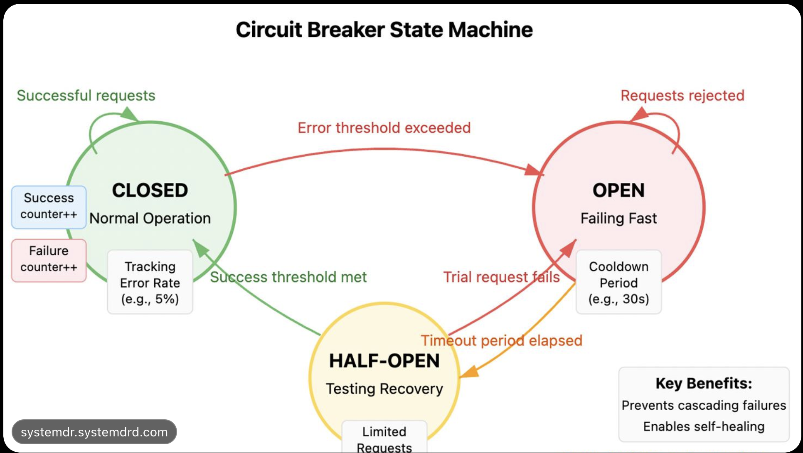

# Circuit Breaker Pattern

A Go playground for exploring the circuit breaker pattern with
[`sony/gobreaker`](https://github.com/sony/gobreaker).

## Circuit breaker states

| State | Behavior |
| --- | --- |
| **Closed** | Requests pass through while failures are monitored. |
| **Open** | Requests fail fast without calling the downstream service. |
| **Half-open** | A limited number of requests check whether the service has recovered. |

Typical transitions:

- **Closed → Open:** The configured failure threshold is reached.
- **Open → Half-open:** The recovery timeout expires.
- **Half-open → Closed:** Test requests succeed.
- **Half-open → Open:** A test request fails.

## Architecture

## Design considerations

For a custom implementation or interview exercise, consider how to manage:

- Current state and state transitions
- Failure counts and the measurement window
- Failure threshold and open-state timeout
- The number of permitted half-open requests
- Thread-safe access to breaker state

<!-- ## Current configuration

The example in [`main.go`](./main.go) configures the breaker to:

- Allow up to 3 requests while half-open.
- Reset closed-state counts every 5 seconds.
- Wait 10 seconds before transitioning from open to half-open.
- Open after at least 5 requests when the failure ratio is 50% or greater.
- Print a message whenever the breaker changes state.

The current program initializes the breaker but does not yet execute protected requests. -->